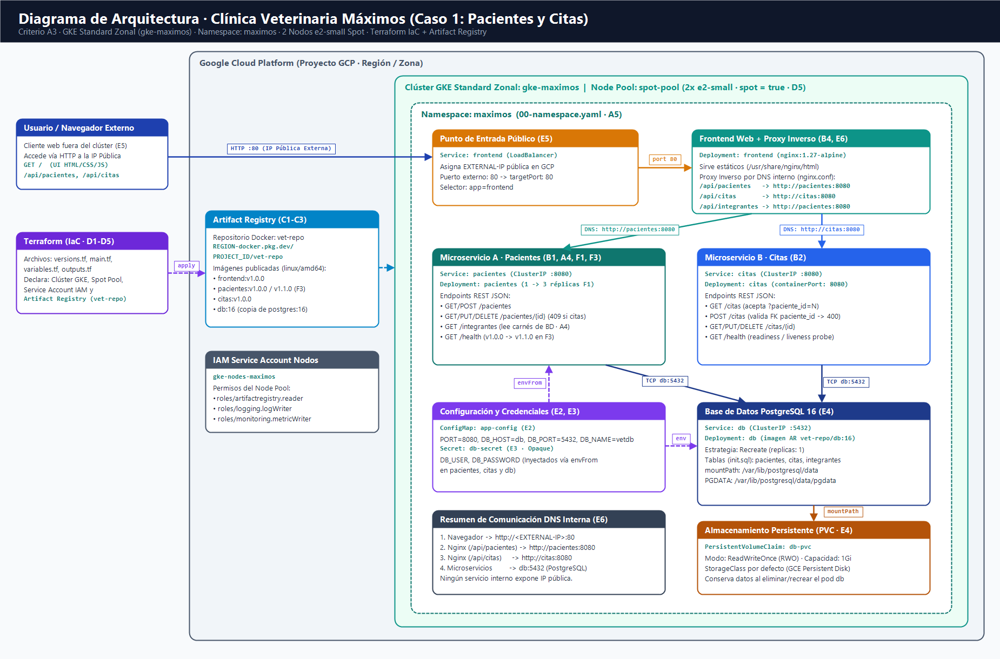

# Clínica veterinaria en Kubernetes

Proyecto final de Virtualización, Universidad Rafael Landívar, segundo semestre de 2026. Equipo Maximos.

## Caso

Caso 1, clínica veterinaria. La aplicación lleva el registro de los pacientes (mascotas y sus propietarios) y de las citas que se programan para cada uno. Se divide en dos microservicios, Pacientes y Citas, un frontend web y una base de datos PostgreSQL. Todo corre en contenedores: en la computadora con Docker Compose, y en Google Cloud sobre un clúster de Kubernetes (GKE) que se crea con Terraform.

## Integrantes

| Nombre | Carné |
| --- | --- |
| José Daniel Paz Ortega | 1200022 |
| Giancarlo Ortega | 1230222 |
| Jorge Francisco Muñoz Portela | 1177523 |
| Julio Javier Robles García | 1248823 |
| Ana Sofía Asturias To | 1078123 |
| Ana Lucía Chávez | 1067423 |

## Arquitectura



El navegador solo habla con el frontend, que es un nginx y el único componente con IP pública (un Service de tipo LoadBalancer). Ese nginx reenvía las rutas que empiezan con /api a los microservicios usando el nombre DNS de cada Service dentro del clúster: /api/pacientes y /api/integrantes van a pacientes:8080, y /api/citas va a citas:8080. Los dos microservicios son internos (ClusterIP) y se conectan a PostgreSQL por el Service db, en el puerto 5432. Los datos de la base viven en un volumen persistente (PVC), así que sobreviven si el Pod se recrea.

La configuración que no es secreta (puerto, host y nombre de la base) está en el ConfigMap app-config. El usuario y la contraseña de la base están en el Secret db-secret y no se suben al repositorio. Todo se despliega en el namespace maximos, dentro del clúster gke-maximos. Las imágenes se guardan en un repositorio de Artifact Registry llamado vet-repo.

## Tecnologías

PostgreSQL 16 como base de datos. Python 3.12 con FastAPI para los microservicios Pacientes y Citas. HTML, CSS y JavaScript plano servidos con nginx para el frontend. Docker y Docker Compose en local. Terraform para crear el clúster y el registro. Kubernetes en GKE, con nodos spot, para correr la aplicación.

## Estructura del repositorio

La carpeta services tiene un directorio por componente, cada uno con su Dockerfile: pacientes, citas y frontend. En db está el script que crea las tablas y carga los datos iniciales. La carpeta terraform define el clúster y el registro. En k8s están los manifiestos, ordenados por componente, y en scripts los comandos que construyen las imágenes y despliegan todo. La documentación y las evidencias están en docs.

## Correr la aplicación en local

Hace falta Docker con Compose. El archivo .env.example del repositorio indica las variables que se deben llenar. Se copia a .env y se escribe un usuario y una contraseña para la base.

```
cp .env.example .env
docker compose up --build
```

Compose levanta cuatro servicios con los mismos nombres que se usan en Kubernetes: db, pacientes, citas y frontend. La aplicación queda disponible en http://localhost:8080. Para apagarla:

```
docker compose down
```

El volumen de la base conserva los datos entre arranques. Si se quiere empezar de cero, se agrega la opción -v a docker compose down.

Las pruebas del microservicio de citas se ejecutan contra una base PostgreSQL real que ya tenga las tablas de db/init.sql. Con la base de Compose levantada y publicada en el puerto 5432:

```
cd services/citas
pip install -r requirements-dev.txt
DB_HOST=localhost DB_NAME=vetdb DB_USER=usuario DB_PASSWORD=clave python -m pytest
```

## API

Los dos microservicios responden JSON y los errores siempre tienen la forma {"error": "mensaje"}. Ambos tienen GET /health, que devuelve el estado y la versión de la imagen.

Pacientes expone GET, POST, PUT y DELETE sobre /pacientes, y GET /integrantes con los nombres y carnés del equipo. Si se intenta borrar un paciente que tiene citas, responde 409.

Citas expone GET, POST, PUT y DELETE sobre /citas, y acepta el filtro /citas?paciente_id=N para ver las citas de un solo paciente. Los campos son paciente_id, fecha_hora (formato ISO 8601), motivo, veterinario y estado, que puede ser programada, completada o cancelada. Si el paciente de una cita no existe, responde 400. Un ejemplo para crear una cita:

```
curl -X POST http://localhost:8080/api/citas -H "Content-Type: application/json" -d '{"paciente_id": 1, "fecha_hora": "2026-11-10T09:30:00", "motivo": "Vacuna anual", "veterinario": "Dra. Morales"}'
```

## Despliegue en Google Cloud

Antes de empezar se necesitan gcloud con el plugin gke-gcloud-auth-plugin, terraform, kubectl y docker, y acceso a un proyecto de Google Cloud con la facturación activa. En los comandos de abajo, PROJECT_ID, REGION y ZONE son el proyecto, la región y la zona que se pusieron en terraform.tfvars.

Primero se inicia sesión y se elige el proyecto:

```
gcloud auth login
gcloud auth application-default login
gcloud config set project PROJECT_ID
gcloud services enable container.googleapis.com artifactregistry.googleapis.com
```

Después se crea la infraestructura con Terraform. En la carpeta terraform se copia terraform.tfvars.example a terraform.tfvars, se llenan los valores propios y se aplica. El archivo terraform.tfvars y el estado de Terraform no se suben a Git.

```
cd terraform
cp terraform.tfvars.example terraform.tfvars
terraform init
terraform plan
terraform apply
cd ..
```

Al terminar existen el clúster gke-maximos, con nodos spot, y el repositorio de imágenes vet-repo. Se conecta kubectl al clúster y se autoriza a Docker para subir imágenes:

```
gcloud container clusters get-credentials gke-maximos --zone ZONE
gcloud auth configure-docker REGION-docker.pkg.dev
```

Se construyen y suben las imágenes para linux/amd64, que es la arquitectura de los nodos. El script también copia la imagen de PostgreSQL al repositorio, porque los manifiestos solo pueden usar imágenes de Artifact Registry:

```
REGION=REGION PROJECT_ID=PROJECT_ID scripts/build-push.sh
```

Luego se escriben la región y el proyecto en las rutas de imagen de los manifiestos, una sola vez:

```
REGION=REGION PROJECT_ID=PROJECT_ID scripts/set-registry.sh
```

Se crea el Secret con las credenciales de la base. Los valores se escriben en el momento y nunca quedan en un archivo del repositorio:

```
kubectl apply -f k8s/00-namespace.yaml
kubectl create secret generic db-secret -n maximos --from-literal=DB_USER=usuario --from-literal=DB_PASSWORD=clave
```

Y se despliega todo en el orden correcto con el script, que espera a que la base esté lista antes de levantar los microservicios:

```
scripts/deploy.sh
```

La IP pública del frontend tarda de uno a tres minutos en aparecer:

```
kubectl get svc frontend -n maximos -w
```

Esa IP se abre desde cualquier navegador.

## Destruir todo

Primero se borran los recursos que creó Kubernetes (el balanceador y los discos), porque Terraform no los conoce y quedarían vivos y cobrando:

```
scripts/deploy.sh delete
```

Después se destruye la infraestructura y se revisa en la consola de Google Cloud que no haya quedado nada:

```
cd terraform
terraform destroy
```

## Evidencias

Las capturas de pantalla de cada criterio de la rúbrica están en docs/evidencias, en una carpeta por sección, y se reúnen en el PDF de entrega.
